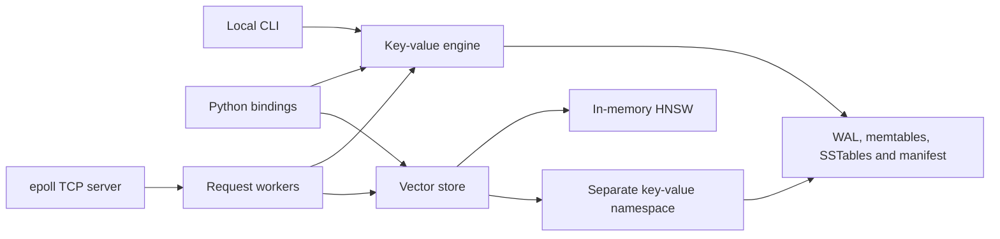
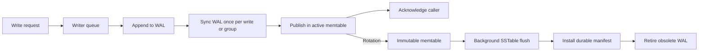
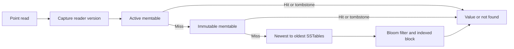
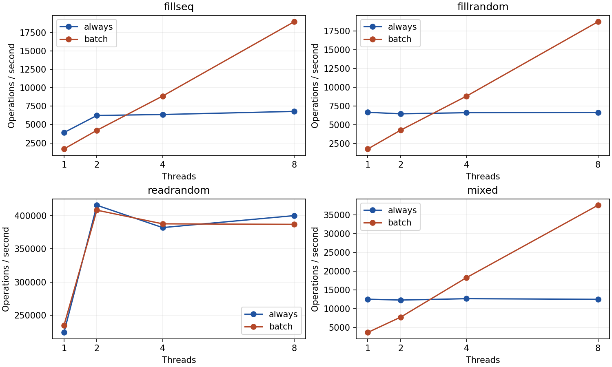
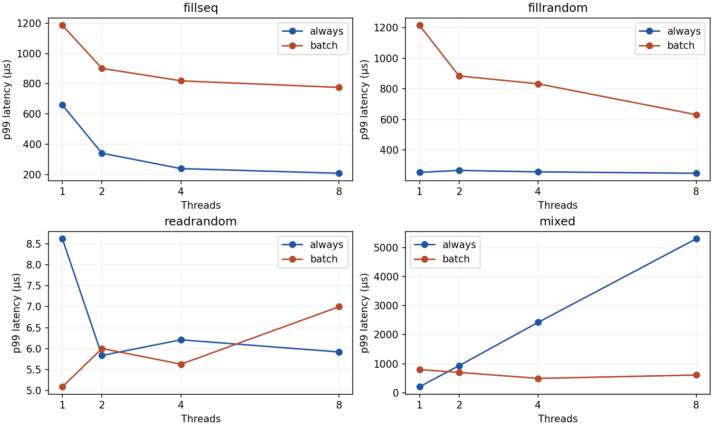

# Strata

[](https://github.com/karthikeyansett1/strata/actions/workflows/ci.yml)

Strata is a crash-safe, multithreaded C++20 LSM storage engine for Linux. It provides concurrent key-value reads, ordered range scans, durable writes with optional group commit, and persistent HNSW vector search. Use it from C++, Python, the local CLI, or a pipelined TCP server backed by epoll.

## Architecture



### Write path



### Read path



Range scans merge sorted rows from the snapshot and return the newest value for each live key in the half-open range `[start, end)`. The [design notes](DESIGN.md) describe the formats, locking, and recovery protocol.

## Quickstart

From a fresh checkout, build the CLI, server, and Python module and run both test suites with one command.

```sh
./scripts/dev.sh ./scripts/verify.sh
```

On macOS the wrapper uses Docker. Set `DOCKER_CONTEXT=colima` when Colima provides Docker. On native Ubuntu, install `build-essential cmake ninja-build git pybind11-dev python3-dev python3-numpy` before running the command. The build is written to `build-verify`.

Use the local CLI against a directory that the server and Python bindings have released.

```sh
build-verify/strata_cli ./data put sample 'hello Strata'
build-verify/strata_cli ./data get sample
build-verify/strata_cli ./data del sample
```

Start the TCP server on Linux and connect from a second terminal.

```sh
build-verify/strata_server --port 7379 --data-dir ./server-data --sync-mode batch --threads 4
printf 'PUT sample hello\nGET sample\nSTATS\n' | nc 127.0.0.1 7379
```

The protocol accepts `PUT`, `GET`, `DEL`, `SCAN`, `STATS`, `VPUT`, and `VSEARCH`. Requests may be pipelined. `SCAN`, `STATS`, and `VSEARCH` finish with `END`. Vector commands take comma-separated coordinates, as in `VPUT example 0.0,1.0` and `VSEARCH 1 0.0,1.0`. The Docker development wrapper runs commands inside an isolated container. Run network examples inside that container or publish the server port explicitly when starting Docker.

On Linux, use `PYTHONPATH=build-verify python3` with the CMake build or install the extension from source with `python -m pip install .`.

```python
from strata import DB

db = DB("./python-data")
db.put("doc/wal", "The WAL is synced before a write is acknowledged.")
db.vput("wal", [0.0, 1.0, 0.0])
print(db.vsearch([0.0, 1.0, 0.0], 1))
```

Python exposes `metric`, `m`, `ef_construction`, and `ef_search` on the constructor. Pass `raw=True` to `get`, `scan`, or `vsearch` for binary results.

## Measured results

These measurements were collected on an ARM64 Linux VM. Times and throughput depend on the hardware and workload.

| Measurement | Result |
|---|---:|
| Server SIGKILL cycles | 500 |
| Acknowledged writes verified / lost | 11,546 / 0 |
| Eight-thread mixed workload, per-write sync | 12,466 ops/s, 5,307 µs p99 |
| Eight-thread mixed workload, group commit | 37,540 ops/s, 610 µs p99 |
| Single-thread random reads, software → hardware CRC32C | 81,254 → 275,511 median ops/s |
| HNSW at ef_search=64, 100,000 vectors and 200 held-out queries | 97.45% recall@10, 20.18× exact-search speedup |





The [benchmark CSV](results/bench.csv), [crash log](results/torture.log), and [vector evaluation](results/vector_eval.csv) contain the underlying results. See the [profiling procedure](DESIGN.md#random-read-profile) for before-and-after runs.

### Reproduce the runs

Use the Release binaries built by the verification command. On macOS, run the commands within the Linux wrapper. Native Linux needs Matplotlib to generate the charts.

```sh
./scripts/run_bench.sh build-verify/strata_bench 20000 results/bench.csv
python3 scripts/plot_bench.py results/bench.csv
./scripts/crash_torture.sh --server build-verify/strata_server --client build-verify/torture_client

python3 -m venv build-vector-cache/venv
build-vector-cache/venv/bin/pip install -r python/evaluation-requirements.txt
build-vector-cache/venv/bin/python scripts/vector_data.py
PYTHONPATH=build-verify build-vector-cache/venv/bin/python scripts/vector_eval.py
PYTHONPATH=build-verify build-vector-cache/venv/bin/python python/examples/rag_demo.py
```

## Limitations

- Strata is a single-node engine. Each database directory has an exclusive open lock. The TCP protocol is plaintext, unauthenticated, and intended for a trusted network.
- Compaction merges all live tables into one level-1 table and materializes their rows in memory. Range scans also materialize their results.
- Vector data uses one dimension per store. The in-memory HNSW graph rebuilds on open and after replacing an ID. Vector and ordinary key-value writes commit independently.
- The crash harness kills the server process while the OS and disk stay running. Its results measure process-crash recovery. Durability also depends on the filesystem and device honoring sync.
